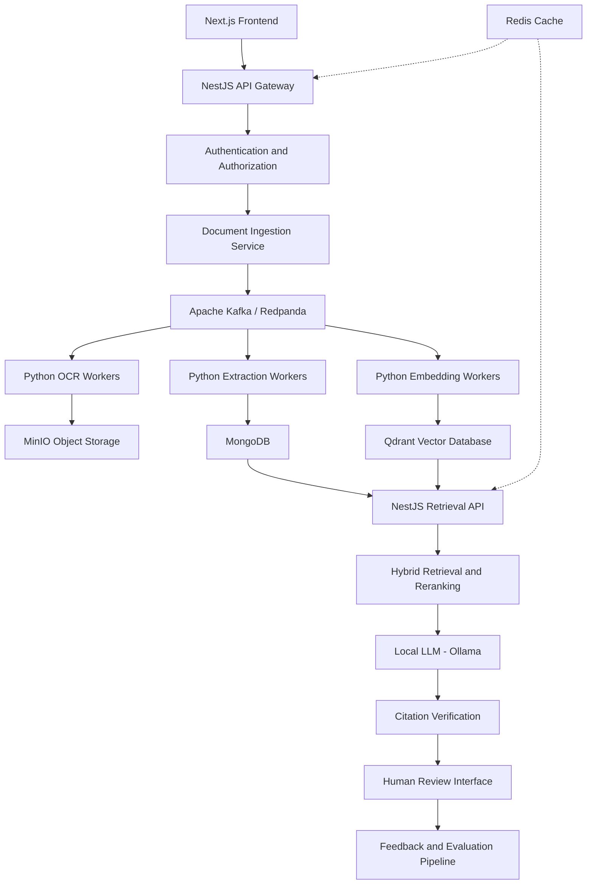
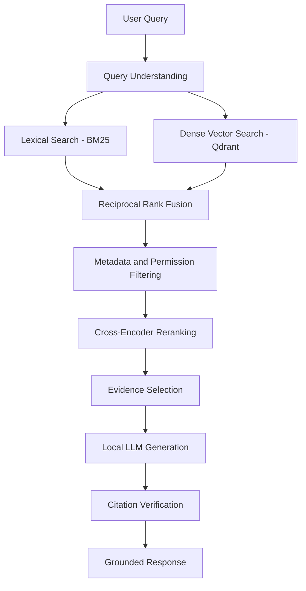

```text
███████╗██╗   ██╗██╗██████╗ ███████╗███╗   ██╗ ██████╗ ███████╗
██╔════╝██║   ██║██║██╔══██╗██╔════╝████╗  ██║██╔════╝ ██╔════╝
█████╗  ██║   ██║██║██║  ██║█████╗  ██╔██╗ ██║██║  ███╗█████╗
██╔══╝  ╚██╗ ██╔╝██║██║  ██║██╔══╝  ██║╚██╗██║██║   ██║██╔══╝
███████╗ ╚████╔╝ ██║██████╔╝███████╗██║ ╚████║╚██████╔╝███████╗
╚══════╝  ╚═══╝  ╚═╝╚═════╝ ╚══════╝╚═╝  ╚═══╝ ╚═════╝ ╚══════╝
```
       RELIABLE AI INFRASTRUCTURE FOR DOCUMENT INTELLIGENCE

  INGEST  →  EXTRACT  →  RETRIEVE  →  VERIFY  →  TRUST

     Every answer grounded in evidence. Every claim traceable.

# EvidenceOS
### Reliable AI Infrastructure for Document Intelligence

**EvidenceOS** is an end-to-end, distributed AI platform that transforms unstructured business documents into structured information, searchable evidence, and verifiable AI-generated outputs.

It combines document processing, OCR, structured extraction, hybrid retrieval, grounded generation, citation verification, and human-in-the-loop learning.

> **Core principle:** Every important AI-generated claim should be traceable to verifiable evidence in its source documents.

Built to explore the intersection of **Distributed Systems, Applied Machine Learning, Information Retrieval, and Production AI Engineering.**

---

## Key Features

- **Multi-format Ingestion:** Process PDF, DOCX, XLSX, CSV, JPG, PNG, and TIFF files.
- **Intelligent Extraction:** Extract text, tables, entities, and structured information using OCR and local LLMs.
- **Automated Validation:** Detect missing fields, duplicate records, financial inconsistencies, and low-confidence extractions.
- **Hybrid RAG:** Combine lexical and semantic retrieval with Reciprocal Rank Fusion (RRF).
- **Grounded Generation:** Generate summaries, reports, and business drafts using retrieved evidence.
- **Citation Verification:** Independently verify whether cited passages support generated claims.
- **Document Comparison:** Identify discrepancies and contradictions across documents.
- **Human-in-the-Loop:** Collect operator corrections, approvals, and feedback.
- **Distributed Processing:** Support asynchronous jobs, retries, idempotency, and failure recovery.
- **ML Evaluation:** Benchmark extraction accuracy, retrieval relevance, citation quality, and processing performance.

---

## System Architecture

EvidenceOS uses an event-driven architecture with independently scalable application and ML services.



### Architecture Principles

- Event-driven, loosely coupled services.
- Independent scaling of CPU-intensive and ML workloads.
- Persistent job state and idempotent processing.
- Fault tolerance and automatic recovery.
- Tenant-aware document access.
- Reproducible ML evaluation.
- Local-first, privacy-conscious LLM inference.

---

## Technology Stack

| Layer | Technology |
|---|---|
| Frontend | Next.js, TypeScript |
| Backend | NestJS, TypeScript |
| API | REST, WebSockets |
| ML Services | Python, FastAPI |
| LLM Inference | Ollama, Local LLMs |
| Primary Database | MongoDB |
| Vector Database | Qdrant |
| Message Broker | Apache Kafka / Redpanda |
| Cache | Redis |
| Object Storage | MinIO |
| OCR | Tesseract, PaddleOCR |
| Document Parsing | PyMuPDF, pdfplumber, python-docx |
| Embeddings | FastEmbed, Sentence Transformers |
| Reranking | Cross-Encoder Models |
| ML Framework | PyTorch, Hugging Face |
| Experiment Tracking | MLflow |
| Testing | Jest, pytest, Hypothesis |
| Load Testing | k6, Locust |
| Observability | OpenTelemetry, Prometheus, Grafana |
| Infrastructure | Docker, Docker Compose |
| CI/CD | GitHub Actions |

---

## Core Modules

| Module | Responsibilities |
|---|---|
| Document Ingestion | Upload, validation, metadata, storage |
| OCR & Extraction | Text, tables, entities, structured fields |
| Validation | Schema checks, financial calculations, anomaly detection |
| Indexing | Chunking, embeddings, vector indexing |
| Retrieval | Keyword search, semantic search, hybrid ranking |
| Generation | Evidence-grounded answers and document drafts |
| Verification | Citation resolution and claim verification |
| Comparison | Document differences and reconciliation |
| Feedback | Human corrections, approvals, audit history |
| Evaluation | Model benchmarks and performance analytics |

---

## Retrieval & RAG Pipeline

EvidenceOS combines lexical and semantic retrieval to improve evidence discovery.



Key retrieval experiments:

- BM25 versus dense retrieval.
- Hybrid retrieval with RRF.
- Fixed-size versus semantic chunking.
- Embedding model comparisons.
- Cross-encoder reranking.
- Query rewriting and decomposition.

---

## Local LLM Architecture

EvidenceOS uses locally hosted language models through **Ollama**, avoiding mandatory dependence on external LLM APIs.

Planned capabilities:

- Structured JSON extraction.
- Evidence-grounded question answering.
- Contract and invoice summarization.
- Document comparison.
- Claim verification.
- Model fallback and configurable routing.
- Quantized model inference.
- Response caching and token-budget management.

The model layer will remain provider-agnostic to support future inference backends.

---

## Distributed Systems & Reliability

Engineering challenges addressed:

- Asynchronous document processing.
- Kafka-based event-driven communication.
- Idempotent task execution.
- Retry with exponential backoff and jitter.
- Dead-letter queues.
- Worker health monitoring.
- Stuck-job recovery.
- Backpressure and admission control.
- Independent worker scaling.
- Distributed tracing and observability.

---

## ML Evaluation Framework

EvidenceOS includes an offline benchmarking framework.

| Component | Evaluation Metrics |
|---|---|
| OCR | Character Error Rate, Word Error Rate |
| Extraction | Precision, Recall, F1 |
| Validation | Precision, Recall |
| Retrieval | Recall@K, MRR, nDCG@K |
| Reranking | nDCG improvement |
| Generation | Faithfulness, Answer Correctness |
| Citations | Citation Precision, Coverage |
| Confidence | Brier Score, Expected Calibration Error |
| Processing | Throughput, P50/P95/P99 Latency |
| Feedback | Correction and Acceptance Rates |

Potential datasets:

- FUNSD
- SROIE
- CORD
- DocVQA
- CUAD
- MS MARCO

All performance claims will be supported by reproducible experiments.

---

## Project Structure

```text
evidenceos/
│
├── apps/
│   ├── web/                 # Next.js frontend
│   └── api/                 # NestJS backend
│
├── services/
│   ├── ingestion/           # Document ingestion
│   ├── ocr/                 # OCR processing
│   ├── extraction/          # Structured extraction
│   ├── validation/          # Business rule validation
│   ├── retrieval/           # Hybrid retrieval
│   ├── generation/          # Local LLM integration
│   ├── verification/        # Citation verification
│   └── feedback/            # Human feedback
│
├── ml/
│   ├── embeddings/
│   ├── reranking/
│   ├── calibration/
│   └── evaluation/
│
├── infrastructure/
│   ├── docker/
│   ├── kafka/
│   ├── mongodb/
│   ├── qdrant/
│   └── monitoring/
│
├── benchmarks/
├── tests/
├── docs/
├── docker-compose.yml
└── README.md
```

---

## Getting Started

### Prerequisites

- Node.js 20+
- Python 3.11+
- Docker and Docker Compose
- Ollama
- Git

### 1. Clone the repository

```bash
git clone https://github.com/YOUR_USERNAME/evidenceos.git
cd evidenceos
```

### 2. Configure environment

```bash
cp .env.example .env
```

### 3. Start infrastructure

```bash
docker compose up -d
```

### 4. Start local LLM

Install Ollama and pull a compatible local model:

```bash
ollama pull qwen2.5:3b
```

### 5. Start backend

```bash
cd apps/api
npm install
npm run start:dev
```

### 6. Start frontend

```bash
cd apps/web
npm install
npm run dev
```

Detailed setup instructions and model requirements will be maintained as implementation progresses.

---

## Development Roadmap

| Phase | Focus |
|---|---|
| 01 | Multi-format ingestion and document storage |
| 02 | OCR, structured extraction, and validation |
| 03 | MongoDB and Qdrant integration |
| 04 | Hybrid retrieval and reranking |
| 05 | Local LLM and grounded generation |
| 06 | Citation verification and document comparison |
| 07 | Human feedback and ML evaluation |
| 08 | Distributed processing and fault tolerance |
| 09 | Security, observability, and performance |
| 10 | Benchmarking and production deployment |

---

## Future Engineering & Research Directions

- Confidence-aware selective prediction.
- Adaptive retrieval and query routing.
- Layout-aware document chunking.
- Efficient embedding and reranking models.
- Quantized local LLM inference.
- Dynamic batching and model optimization.
- Feedback-driven retrieval improvement.
- Evidence conflict detection.
- Multimodal document understanding.

---

## Engineering Focus

EvidenceOS is designed to demonstrate practical engineering across:

- **Software Engineering:** TypeScript, NestJS, API design, testing, modular architecture.
- **Distributed Systems:** Kafka, asynchronous workers, fault tolerance, idempotency.
- **Machine Learning:** OCR, embeddings, reranking, confidence calibration, evaluation.
- **AI Engineering:** Local LLMs, RAG, citation verification, grounded generation.
- **Data Engineering:** Document pipelines, NoSQL storage, indexing, data quality.
- **Performance Engineering:** Benchmarking, load testing, caching, inference optimization.

---

## Author

**Nazmul Alam**

Computer Science & Engineering | Applied Machine Learning | ML Systems | AI Infrastructure

- GitHub: https://github.com/diptu
- Portfolio: https://diptuverse.com

---

<p align="center">
  <b>EvidenceOS</b>
  <br/>
  <i>From unstructured documents to verifiable intelligence.</i>
</p>
